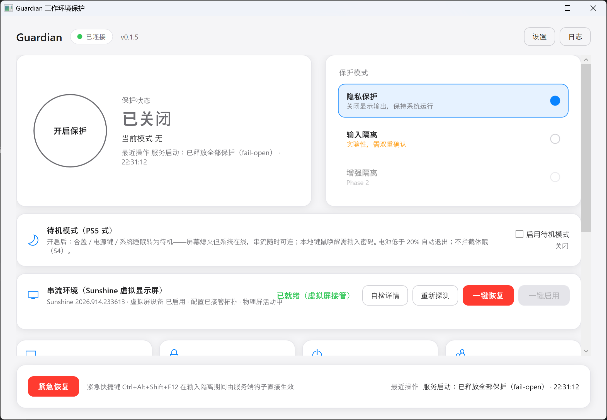
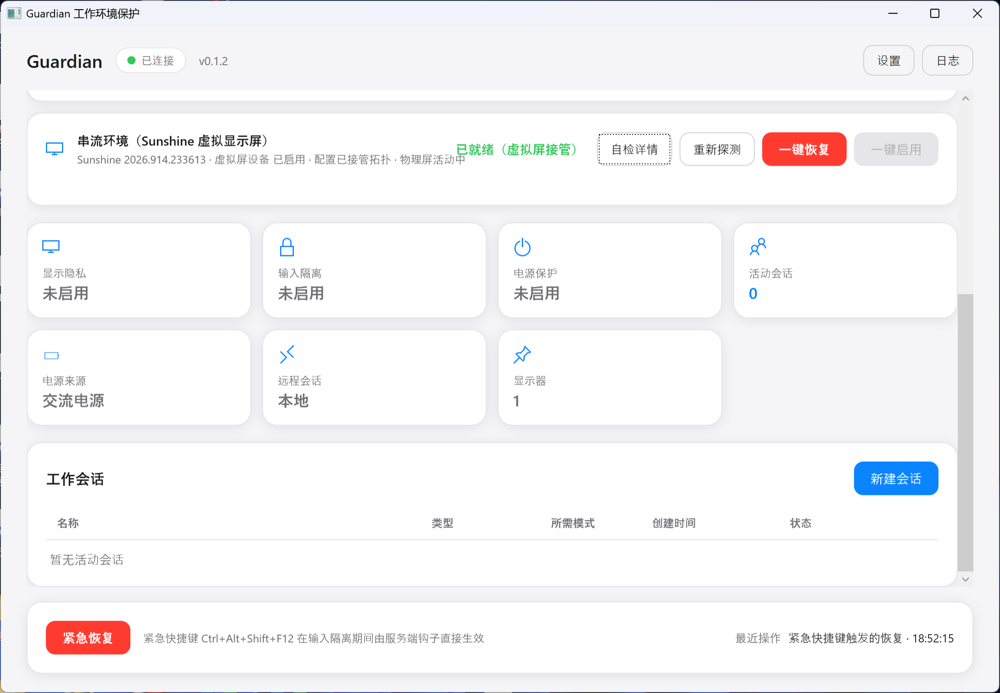
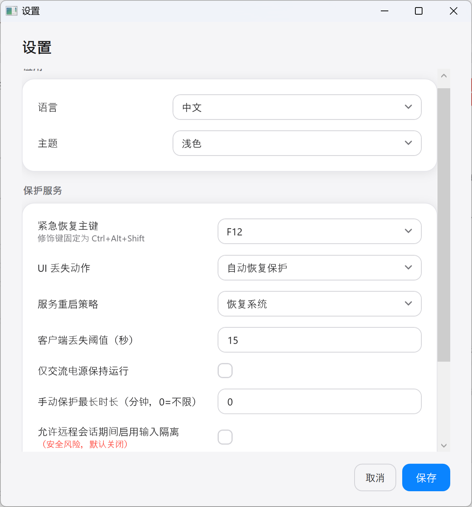
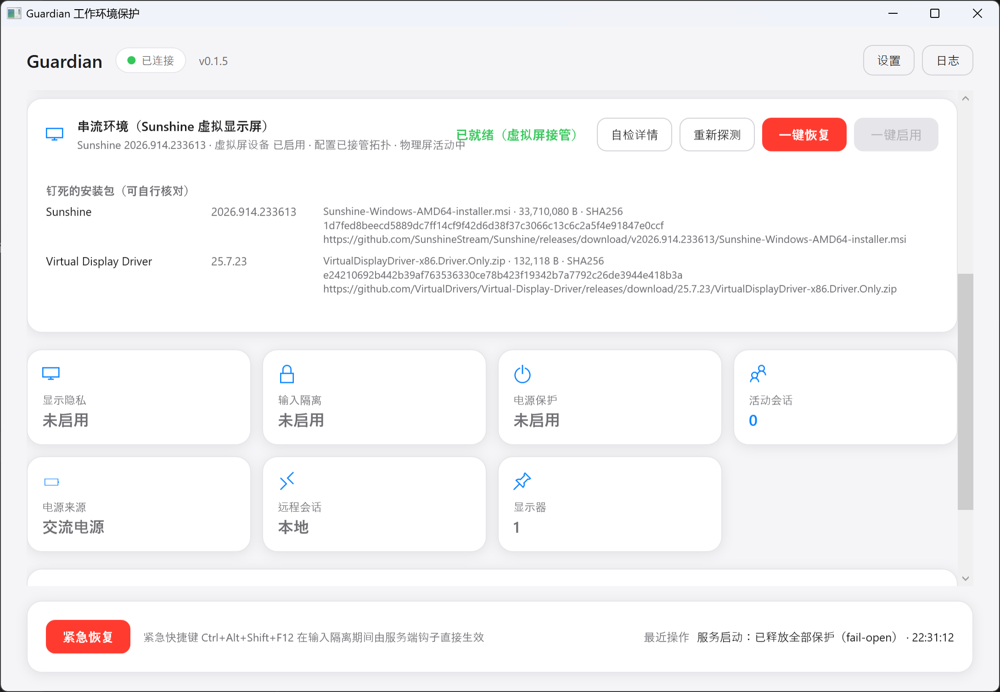

# Project Guardian

**AI 时代，让无人值守的 Windows 工作环境更安全**

AI Agent、RPA 与自动化任务在后台持续运行；人离开工位时，物理屏熄灭、本地键鼠被隔离，远程端画面照常流畅——任务不被打断，屏幕内容不被旁人看见。

[](https://github.com/GH17812/Guardian/releases/download/v0.1.5/Guardian-0.1.5.msi)




**它能做什么**

- **一键部署**：自动安装 Sunshine、启用虚拟显示器并完成接管，远程端直接开播；一键恢复普通串流模式。
- **无人值守保护**：AI Agent、RPA、编译渲染等长任务运行时自动熄屏并隔离本地输入，人不在也能安全运行。
- **两种保护模式**：隐私保护只熄屏；输入隔离熄屏并隔离本地键鼠，避免误操作影响远程任务。
- **PS5 式待机**：取代 Windows 休眠，屏幕熄灭但系统在线，维持最低串流需求；本地唤醒需密码。
- **紧急恢复**：本地 `Ctrl+Alt+Shift+F12` 由服务端直接识别，不依赖界面，一键退出保护。
- **离线可用**：v0.1.5 内置 Sunshine 与 VDD 驱动，自包含运行时，装完即用。

运行于 Windows 10/11 的本地工作环境保护与管理软件。为远程桌面、AI Agent、本地自动化及无人值守任务提供统一的保护层：显示隐私、输入隔离、系统持续运行、工作会话管理、双向恢复与异常保护。

> 本产品不负责远程画面传输、AI 推理或替代任何 Agent 平台；它只管理 Windows 主机在任务执行期间的保护状态。

## 适用场景

| 场景 | 用法 |
|---|---|
| **远程办公** | 在家或差旅中用 Moonlight 接管工位主机，物理屏在工位保持熄灭，文档与内部资料不外露。 |
| **游戏串流** | 平板或轻薄本远程连回家用主机，虚拟显示器稳定输出画面，本地键鼠隔离避免误触。 |
| **远程科研** | 训练、仿真、实验在主机后台长时间运行，人离开后熄屏并隔离输入，随时远程查看进度。 |
| **AI Agent 无人值守** | Agent、RPA 与自动化脚本执行期间保持熄屏与输入隔离，任务结束一键恢复。 |

## 核心原则

- 用户拥有最终控制权；故障时优先恢复用户控制权（fail-open）。
- 手动保护是基础，自动化管理是扩展。
- 本地与远程均可恢复；本地紧急恢复优先级最高。
- 界面状态与服务真实状态一致；无法确认时显示"未知/异常"，绝不假报成功。
- 不以进程存在作为任务仍在运行的唯一依据。
- 不保存屏幕内容、键盘输入内容或 AI 对话内容。

## 下载与安装

适用于 Windows 10/11 x64，安装包均为自包含版本（目标机无需预装 .NET 运行时）：

| 版本 | 安装包 | 说明 |
|---|---|---|
| **v0.1.5（推荐）** | [Guardian-0.1.5.msi](https://github.com/GH17812/Guardian/releases/download/v0.1.5/Guardian-0.1.5.msi) | 离线完整版：内置 Sunshine 安装包与虚拟显示器驱动，安装后"一键启用"无需联网。 |
| v0.1.2（历史） | [Guardian-0.1.2.msi](https://github.com/GH17812/Guardian/releases/download/v0.1.2/Guardian-0.1.2.msi) | 在线下载版：首次"一键启用"需联网从 GitHub 下载 Sunshine 与驱动，国内网络需智能代理。 |

## 应用截图

| 主界面 | 运行详情 |
|---|---|
|  |  |

| 设置 | 串流环境自检 |
|---|---|
|  |  |

## 当前版本（V0.1.5，Phase 1）

| 能力 | 状态 | 说明 |
|---|---|---|
| 后台服务 + 桌面客户端 | 已实现 | .NET 10 Worker Service + WPF |
| 保护状态机与工作会话管理 | 已实现 | 多会话策略聚合、会话超时、手动/会话并存 |
| 电源管理（防休眠） | 已实现 | 官方 `SetThreadExecutionState` API，可释放、不修改电源计划 |
| 显示隐私（关闭本地显示器） | 已实现 | `SC_MONITORPOWER` 广播；**远程捕获兼容性需按 §兼容性验证 实测确认** |
| 输入隔离（本地键鼠） | 实验性 | 低层钩子 + INJECTED 标记过滤；默认关闭，启用需双重确认（见已知限制） |
| 增强隔离（触摸屏/触控板/手写笔/手柄） | 未实现 | Phase 2 |
| 本地紧急恢复 | 已实现 | 服务端钩子识别 `Ctrl+Alt+Shift+F12`（不依赖 UI）+ 界面一键恢复 |
| 远程恢复接口 | 基础 | 本地授权控制通道（Named Pipe）+ 身份校验；远程接入适配器为 Phase 3 |
| 异常自动恢复 | 已实现 | UI 丢失、适配器失败、服务启动 fail-open 恢复；服务崩溃由 SCM 自动重启 + 启动恢复 |
| 日志与设置 | 已实现 | Serilog 文件日志 + SQLite 操作日志；设置持久化 |
| 安装/卸载 | 已实现 | MSI 安装包（0.1.5 起内置离线依赖）+ 安装/卸载脚本 |

## 架构

```
Guardian/
├─ src/
│  ├─ Guardian.App            WPF 桌面客户端（界面、模式切换、会话、设置、日志、托盘）
│  ├─ Guardian.Core           保护引擎（状态机、会话、策略聚合、恢复协调；不依赖 WPF 与系统 API）
│  ├─ Guardian.Contracts      IPC 协议、枚举、DTO（各层共享契约）
│  ├─ Guardian.Infrastructure Named Pipe 服务端/客户端、调用方身份校验、服务控制
│  ├─ Guardian.Storage        SQLite 持久化（设置/会话/日志/恢复/能力报告）
│  ├─ Guardian.Windows        Windows API 适配层（显示/电源/输入/能力检测/PInvoke）
│  └─ Guardian.Service        后台服务（Worker Service，宿主引擎与 IPC）
├─ tests/                     xUnit（Core 单元、协议序列化、存储/管道/适配器集成）
├─ installer/                 安装与卸载脚本
├─ scripts/                   构建与发布脚本
└─ docs/                      文档
```

- UI 不做高权限系统操作；所有系统操作经 `Guardian.Windows` 适配层，由服务（SYSTEM）执行。
- 客户端与服务通过命名管道通信：管道 ACL 限制本机用户，敏感命令（启用/解除/恢复/会话/设置）逐连接校验调用进程身份（受信任进程名 / 安装目录 / 提权调用方）。
- 服务启动即执行 fail-open 恢复；`ResumePolicy=ResumeLast` 时按持久化会话恢复保护（无人值守场景）。
- 故障处理：适配器异常 → 立即恢复并置 `Failed`；UI 心跳丢失 → 默认自动恢复（可配置为保持保护）；电池供电（开启"仅交流电"时）→ 挂起电源请求。

## 构建与运行

要求：Windows 10/11、.NET 10 SDK（用户级安装即可）：

```powershell
# 如本机无 SDK：下载安装脚本（或安装 Visual Studio 2022 + .NET 10 工作负载）
iwr https://dot.net/v1/dotnet-install.ps1 -OutFile $env:TEMP\dotnet-install.ps1
powershell -ExecutionPolicy Bypass -File $env:TEMP\dotnet-install.ps1 -Channel 10.0 -InstallDir $env:USERPROFILE\.dotnet -NoPath

# 构建 + 测试
$env:PATH = "$env:USERPROFILE\.dotnet;$env:PATH"
dotnet build Guardian.slnx -c Release
dotnet test Guardian.slnx -c Release

# 本地运行（开发模式：服务以控制台运行，数据写入 %LOCALAPPDATA%\Guardian）
dotnet run --project src/Guardian.Service   # 终端 1：服务（控制台模式）
dotnet run --project src/Guardian.App       # 终端 2：客户端
```

## 安装（正式部署）

```powershell
powershell -ExecutionPolicy Bypass -File scripts/publish.ps1          # 1. 发布
powershell -ExecutionPolicy Bypass -File installer/install.ps1        # 2. 安装（UAC 提权）
# 或构建 MSI 安装包（可选，自动按需安装 WiX v4 工具到仓库 tools 目录）：
powershell -ExecutionPolicy Bypass -File installer/build-wix.ps1      # → artifacts\installer\Guardian-0.1.5.msi
# 卸载：
powershell -ExecutionPolicy Bypass -File installer/uninstall.ps1                  # 保留数据
powershell -ExecutionPolicy Bypass -File installer/uninstall.ps1 -RemoveData      # 彻底清除
```

安装后：服务 `GuardianService`（自动启动、崩溃自动重启）以 SYSTEM 运行；数据与日志位于 `C:\ProgramData\Guardian`；桌面与开始菜单出现 Guardian 快捷方式。

## 使用说明

### 安装（傻瓜式）

下载并双击 `Guardian-x.y.z.msi`，一路“下一步”完成安装；安装包自带 .NET 运行时，目标机无需预装环境。安装后桌面与开始菜单会生成快捷方式，服务 `GuardianService` 自动注册并随系统启动。

- **v0.1.5 离线完整版（优先选择）**：内置 Sunshine 与虚拟显示器驱动（VDD）安装包，“一键启用”全程无需联网。
- **v0.1.2 在线下载版**：未内置离线文件，首次“一键启用”需联网从 GitHub 下载 Sunshine 与驱动，国内网络需要智能代理。

### 一键式部署

- 主界面点击 **一键启用**：自动完成 Sunshine 安装、虚拟显示屏启用、接管拓扑配置等步骤，并在“串流环境”卡片中逐步显示执行结果。
- 点击 **一键恢复**：回到 Sunshine 普通串流模式，撤销虚拟屏接管。
- 展开“串流环境”可核对钉死安装包的版本与 SHA256，并用“自检详情”查看每一步的取证信息。

### 窗口控制与设置

- 主界面集中展示保护状态、保护模式、待机模式与串流环境，底部常驻“紧急恢复”按钮；下方能力卡片展示显示隐私、输入隔离、电源保护、活动会话、电源来源、远程会话与显示器数量。
- 设置页可切换 **语言**（中文/英文）与 **主题**（浅色/深色），并调整保护服务参数：紧急恢复键、UI 丢失动作、服务重启策略、客户端丢失阈值、仅交流电保持运行、手动保护最长时长、是否允许远程会话期间启用输入隔离等。

### 开机自启动与隐私

- 默认开机自启动并拉起串流，物理屏自动熄灭以保护隐私。
- 未开启保护时退出串流，物理屏会恢复点亮。

### 两种保护模式

| 模式 | 行为 |
|---|---|
| 隐私保护 | 只关闭物理屏幕，不阻止本地端输入 |
| 输入隔离 | 关闭物理屏幕，并隔离本地键鼠输入，避免本地操作影响远程端 |

### 紧急恢复

本地紧急恢复键默认为 `Ctrl+Alt+Shift+F12`（主键可在设置中更换），由服务端钩子直接识别，不依赖界面与网络，一键退出保护模式。

### 待机模式（PS5 式）

开启后取代 Windows 底层休眠（S4）：屏幕熄灭但系统保持在线，只维持最低的串流需求。待机期间用本地键鼠唤醒需要输入密码，避免本地端误操作影响远程任务。

### 串流分辨率建议

Moonlight 端视频分辨率最高请选择 **4K**；低于 4K 时可能没有对应的本地分辨率适配，导致虚拟显示器无法正常串流。

### 机型适配说明

- 已适配大部分机型。部分游戏本在**独显直连模式**下虚拟屏可能无法被枚举命中，属于机器本身的显卡驱动问题；切换到智能/混合模式后可正常启用。
- 部分机型在启动保护、启动串流或开启待机模式时只停画面信号、不熄灭背光，属于电脑自身设计问题（多见于智能模式）。检验标准：直接用电脑自身的休眠模式，观察背光是否熄灭。

> 更多细节见 [用户操作说明](docs/用户操作说明.md)。

## 已知限制（诚实声明）

- **显示隐私**：关闭本地显示器基于电源消息，对 RDP/Sunshine/Parsec 等基于桌面捕获的方案通常无影响，但需按 docs/技术兼容性报告.md 在目标环境实测。本地物理输入会唤醒显示器，隐私模式会周期重申关闭。
- **输入隔离（实验性）**：
  - 拦截"无 INJECTED 标记"的键鼠事件；RDP 输入栈等少数远程方案的输入可能不带该标记而被误拦截 → 默认拒绝在 RDP 会话中启用（设置可覆盖）。
  - 钩子回调超时可能被系统摘除；安全桌面（Ctrl+Alt+Del/UAC）输入不受影响。
  - 蓝牙/USB 键鼠均经同一 HID 输入路径，被一并隔离（能力报告按类型枚举设备）。
- **电源**：Modern Standby 设备上 `ES_SYSTEM_REQUIRED` 行为可能不同（Phase 0 专项验证项）。
- 未安装内核驱动（符合安全设计：驱动为 Phase 2+ 可选方案）。

## 测试

- `Guardian.Core.Tests`：状态机、策略聚合、会话超时、恢复顺序/部分失败、心跳策略、AC 挂起/恢复、fail-open。
- `Guardian.Contracts.Tests`：协议序列化契约。
- `Guardian.Integration.Tests`：SQLite 往返、真实命名管道端到端（含未授权拒绝）、真实电源适配器（不触碰真实显示器/钩子）。

## 路线图（对照产品总纲）

- **Phase 0 技术验证**：见 docs/Phase0验证清单.md（显示隐私实测、输入区分实测等）。
- **Phase 2**：经过验证的输入隔离、双向恢复强化、异常自动恢复全覆盖、增强隔离（多类 HID）、设备兼容矩阵。
- **Phase 3**：本地 API/CLI、Agent 接入协议、工作负载自动识别、外部控制授权。
- **Phase 4**：授权体系、多设备集中管理、SDK、OEM。

## 文档

- [用户操作说明](docs/用户操作说明.md)
- [架构说明](docs/架构说明.md)
- [技术兼容性报告（模板与填写指南）](docs/技术兼容性报告.md)
- [Phase 0 验证清单](docs/Phase0验证清单.md)
